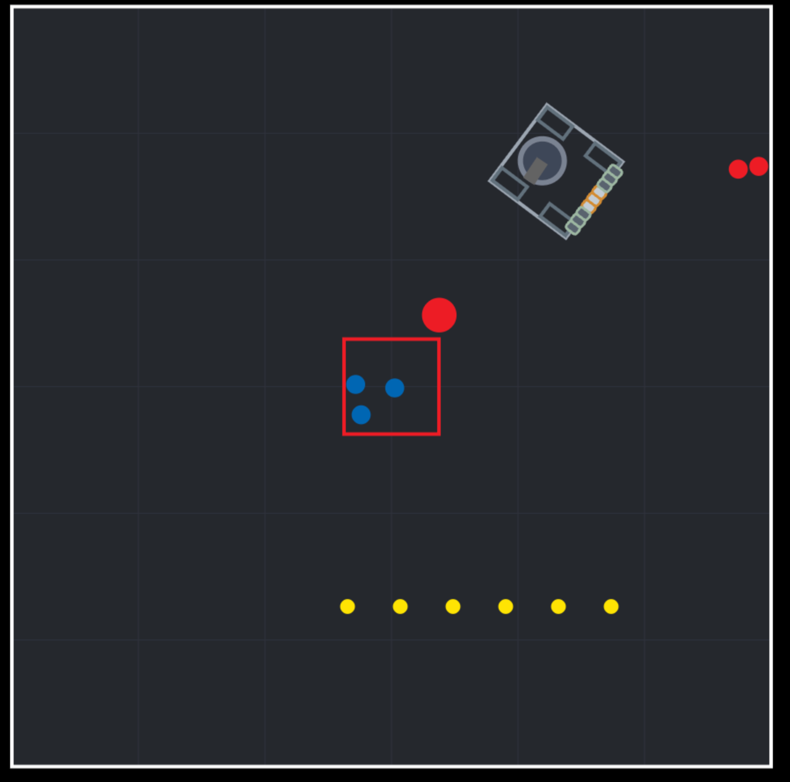
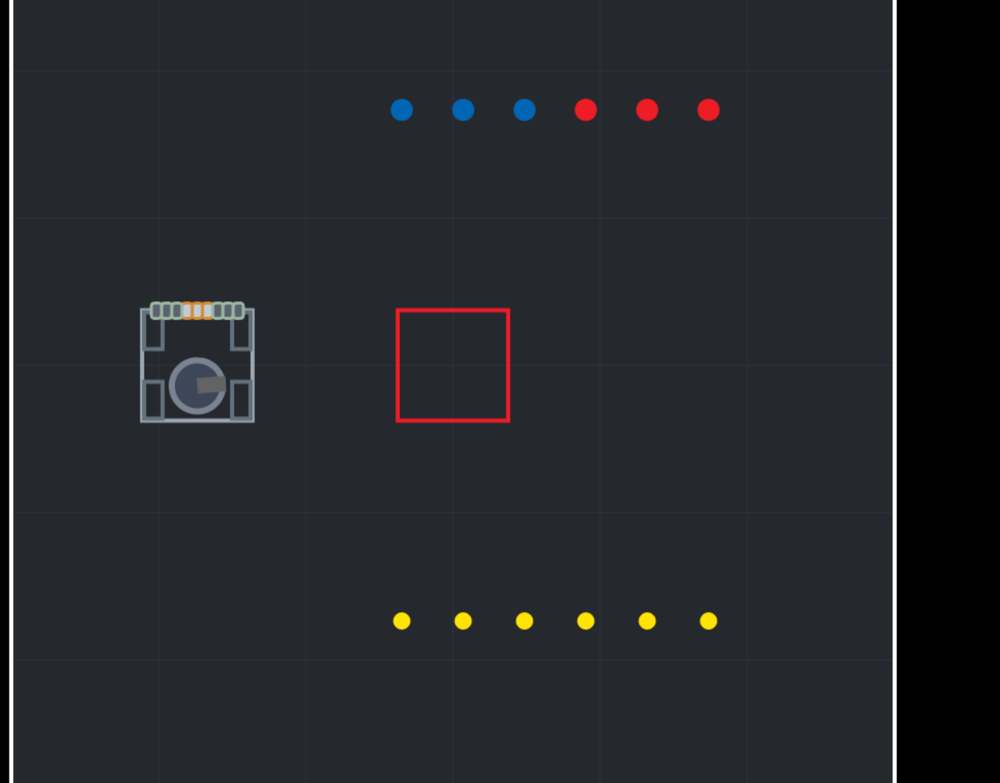

# YARS

YARS (Yet Another Robotics Simulator) is a small browser-based robotics simulator built with React, TypeScript, and the HTML Canvas API.

The plan is to add 3d but it will be 2d for now. It was made for my robotics teams as I compete in FIRST Tech Challenge

<>

## Screenshots





## How to run

1. Install dependencies:

   ```bash
   npm install
   ```

2. Start the development server:

   ```bash
   npm run dev
   ```

3. Open the local URL shown in the terminal, then click the canvas to focus it.

## Controls

- `W` / `S` or `↑` / `↓`: drive forward/backward
- `A` / `D` or `←` / `→`: strafe left/right
- `Q` / `E`: rotate left/right
- `Space': Shoot

## Production build

```bash
npm run build
npm run preview
```